# Weekly planning cycle: swimlane process map

Rendered by GitHub. Lanes are roles; the dashed arrow is the weekly loop.

```mermaid
flowchart LR
  subgraph DS["Data Steward"]
    A["Receive market extracts"] --> B["Run data quality checks"]
    B --> C{"Failures?"}
    C -->|yes| D["Fix upstream or quarantine rows"]
    D --> E["Raise data action"]
  end
  subgraph PA["Planning Analyst"]
    F["Build clean layer and KPIs"] --> G["Raise exceptions and anomaly flags"]
    G --> H["Draft exception summary"]
    H --> I{"Approved by a person?"}
    I -->|no| H2["Edit draft"]
    H2 --> I
    I -->|yes| J["Publish status note, deck, workbook"]
  end
  subgraph PL["Demand and Supply Planners"]
    K["Weekly planning review"] --> L["Decisions become tracked actions"]
    L --> M["Owners work the actions"]
  end
  subgraph PR["Procurement"]
    N["Chase late POs and supplier gaps"]
  end
  subgraph ML["Market and ISCP Leads"]
    O["Level 1 escalation: market lead"] --> P["Level 2 escalation: ISCP lead"]
  end
  B --> F
  C -->|no| F
  E --> F
  J --> K
  M --> N
  M --> Q{"Past due?"}
  N --> Q
  Q -->|yes| O
  Q -->|no| R["Close action"]
  P --> R
  R -. "next week" .-> A
```

## Where the gaps are
See `gap_log.csv`. The main ones: no named data steward per market, no rule for the assumed arrival date of a late PO, and meeting decisions that are not tracked unless they use the meeting notes template.
